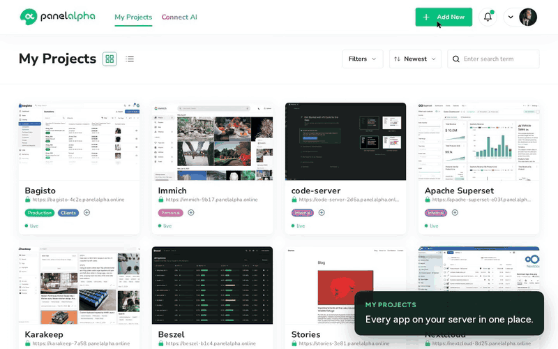

<div align="center">

<p align="center"><picture><source media="(prefers-color-scheme: dark)" srcset="../assets/panelalpha.svg"></picture></p>

<h1>Un panel d'hébergement<br>pour votre propre serveur.</h1>

<h3>
Sites, domaines, sauvegardes et staging dans votre navigateur. Il tourne sur PanelAlpha Engine.
</h3>

<h3>
<a href="#mettez-le-panel-en-route"><b>Démarrer</b></a> ·
<a href="https://www.panelalpha.com/documentation/single-server-edition"><b>Documentation</b></a> ·
<a href="#parlez-nous-sur-discord"><b>Discord</b></a>
</h3>

<p>
<a href="#où-trouver-quoi">Dans le panel</a> ·
<a href="#connectez-votre-assistant-ia">Connect AI</a> ·
<a href="#panelalpha-hub">Hub</a> ·
<a href="#faq">FAQ</a>
</p>

<p>
<a href="../../README.md">English</a>
· <a href="README.pl.md">Polski</a>
· <a href="README.de.md">Deutsch</a>
· <a href="README.nl.md">Nederlands</a>
· <a href="README.es.md">Español</a>
· <b>Français</b>
· <a href="README.it.md">Italiano</a>
· <a href="README.pt-BR.md">Português</a>
· <a href="README.uk.md">Українська</a>
· <a href="README.ar.md">العربية</a>
· <a href="README.zh-CN.md">简体中文</a>
</p>

<p>
<a href="#étape-1--installez-le-panel-sur-votre-vps"></a>
<a href="#étape-1--installez-le-panel-sur-votre-vps"></a>
<a href="#licence"></a>
<a href="https://discord.gg/9twHWR7xGX"></a>
</p>

</div>

---

## Qu'est-ce que PanelAlpha Single Server Edition ?

PanelAlpha Single Server Edition est un panel d'hébergement web que vous installez sur votre propre VPS. Vous l'ouvrez dans un navigateur et vous y gérez vos sites : WordPress, apps depuis Git, domaines, sauvegardes et le reste. PanelAlpha Engine assure l'hébergement en dessous, et le panel vous donne un écran pour le piloter.

L'édition Community est pour une seule personne et n'a pas de limite de projets. Dans le panel, vous pouvez :

- Créer un site WordPress, déployer une app depuis Git ou depuis des fichiers, ou installer une app testée du catalogue PanelAlpha GO!
- Importer un site WordPress depuis un autre hébergeur
- Ajouter des domaines, avec des certificats Let's Encrypt
- Faire des sauvegardes à la main ou selon un planning, et les restaurer
- Garder une copie de staging d'un site et la mettre en production
- Gérer les bases de données, les cron jobs, les comptes FTP et SFTP et les réglages PHP
- Voir les statistiques de visites, l'utilisation et les logs
- Connecter un assistant IA et gérer vos projets par chat
- Connecter le serveur à votre compte PanelAlpha Hub et vous connecter avec

## Comment ça marche

<div align="center"><br><a href="../assets/panelalpha-tour.mp4">Voir la visite complète (2,5 min, MP4)</a></div>

Le panel est un projet de l'engine, dans son propre conteneur. Quand vous créez un site, le panel demande à l'API de l'engine de le faire, et l'engine donne à ce site un projet à part. Retirer le panel supprime seulement le projet du panel. Vos sites continuent de tourner.

## Pourquoi utiliser le panel

PanelAlpha Engine se pilote depuis un assistant IA ou avec la commande `pae` sur le serveur. Le panel met ce même travail sur un écran. Vous pouvez ajouter un domaine, restaurer une sauvegarde ou mettre une copie de staging en production en quelques clics, et voir tous les sites du serveur dans une seule liste. Quand vous voulez l'aide d'un assistant, vous le connectez au panel et il travaille sur les mêmes projets.

## Mettez le panel en route

### Étape 1 : Installez le panel sur votre VPS

Il vous faut un serveur neuf sous Debian 12/13 ou Ubuntu 22.04/24.04/26.04, avec 2 Go de RAM, un accès `root` en SSH et un domaine qui pointe vers lui. **Le port 80 doit être ouvert à tout le monde**, car Let's Encrypt l'utilise.

```bash
curl -fsSL get.panelalpha.com/single-server | sh
```

Toutes les options et la version d'Engine dont le panel a besoin : [Installing the panel](https://www.panelalpha.com/documentation/single-server-edition/getting-started/install).

### Étape 2 : Connectez-vous

Ouvrez `https://panel.example.com`. L'assistant de configuration crée votre compte, ou connecte votre compte PanelAlpha Hub, puis ouvre le panel : [First login](https://www.panelalpha.com/documentation/single-server-edition/getting-started/first-login).

### Étape 3 : Créez votre premier site

Allez dans **My Projects**, sélectionnez **Create First Project** et choisissez **WordPress**, **Git**, **Files** ou **PanelAlpha GO!**. Vous pouvez aussi déposer une archive `.zip` ou `.tar.gz` directement sur la liste des projets : [Create a project](https://www.panelalpha.com/documentation/single-server-edition/projects/create-a-project).

**PanelAlpha GO!** est un catalogue d'apps open source que PanelAlpha a déployées et testées sur PanelAlpha Engine. Vous choisissez une app et le panel l'installe, sans rien d'autre à remplir. Le catalogue s'affiche une fois le panel connecté à [PanelAlpha Hub](#panelalpha-hub).

<div align="center">
<a href="https://www.panelalpha.com/documentation/single-server-edition/projects/create-a-project"></a>
<br>
WordPress, ou toute app que l'engine peut construire depuis un dépôt Git ou un dossier de fichiers.
</div>

## Où trouver quoi

Sélectionnez **Manage** sur un projet pour l'ouvrir. Ses onglets sont **Project Details**, **Monitoring**, **Backups**, **Plugins** et **Advanced**. **Plugins** n'apparaît que sur un site WordPress.

| Vous voulez | Dans le panel |
|:---|:---|
| Mettre votre propre domaine sur un site | **Advanced > Domains**, puis **Add Domain** |
| Faire une sauvegarde, ou sauvegarder selon un planning | Onglet **Backups**. Configurez un stockage une fois dans **Settings > Backups** |
| Essayer un changement avant sa mise en ligne | **Staging** dans la barre supérieure du projet, puis **Push To Live** |
| Redéployer à chaque git push | **Advanced > Git**, puis **Auto-deploy on push** |
| Déplacer un site WordPress depuis un autre hébergeur | Créez un projet, **WordPress**, puis **Import Existing WordPress Project** |
| Ajouter une base de données et un utilisateur pour elle | **Advanced > MySQL Databases** |
| Donner un accès SFTP à quelqu'un | **Advanced > SFTP Accounts** |
| Lancer un script selon un planning | **Advanced > Cron Jobs** |
| Changer la version de PHP ou `memory_limit` | **Advanced > Developer Settings** |
| Voir combien de personnes visitent le site | Onglet **Monitoring** |

## Tout ce dont un site a besoin, dans le panel

- **Domaines et HTTPS.** Faites pointer votre propre domaine vers un site, ajoutez d'autres domaines et des redirections, et donnez à chacun un certificat Let's Encrypt. Sans domaine pour l'instant, utilisez un sous-domaine gratuit si votre serveur en propose un. [Domains and SSL](https://www.panelalpha.com/documentation/single-server-edition/looking-after-a-project/domains-and-ssl)
- **Des sauvegardes que vous pouvez restaurer.** Sauvegardez à la main ou chaque jour, semaine ou mois, vers S3, SFTP, FTP, FTPS ou un dossier local. Sur un site WordPress, vous pouvez restaurer les fichiers et la base de données séparément. [Backups](https://www.panelalpha.com/documentation/single-server-edition/looking-after-a-project/backups)
- **Staging.** Faites une copie d'un site, essayez vos changements dessus, puis envoyez les fichiers, la base de données complète ou certaines tables vers le site en production. Un projet Git peut déployer une branche en staging et laisser la production intacte. [Staging and preview](https://www.panelalpha.com/documentation/single-server-edition/projects/staging-and-preview)
- **Git.** Voyez de combien de commits le site est en retard, redéployez, changez de branche et suivez le log de déploiement pendant son exécution. Avec l'auto-deploy activé, un push vers GitHub, GitLab ou Bitbucket redéploie le site. [Git](https://www.panelalpha.com/documentation/single-server-edition/projects/git)
- **WordPress.** Connectez-vous au tableau de bord sans mot de passe, mettez à jour WordPress et WooCommerce, installez des plugins et des thèmes par leur nom sur wordpress.org, gérez les utilisateurs WordPress et activez les mises à jour automatiques. [Managing WordPress](https://www.panelalpha.com/documentation/single-server-edition/projects/wordpress)
- **Fichiers, FTP et SFTP.** Modifiez, envoyez, compressez et décompressez des fichiers dans le gestionnaire de fichiers, ou donnez à un programme comme FileZilla un compte FTP ou SFTP. [Files and access](https://www.panelalpha.com/documentation/single-server-edition/looking-after-a-project/files-and-access)
- **Bases de données.** Créez des bases de données et des utilisateurs MySQL, réglez leurs privilèges et ouvrez phpMyAdmin depuis le panel. [Databases](https://www.panelalpha.com/documentation/single-server-edition/looking-after-a-project/databases)
- **Statistiques et logs.** Les visites par pays, provenance et appareil, la bande passante, le CPU, la RAM et le disque de tout le serveur, et les logs PHP et du serveur web de chaque site. [Statistics and logs](https://www.panelalpha.com/documentation/single-server-edition/looking-after-a-project/statistics-and-logs)

## Connectez votre assistant IA

Vous connectez votre assistant depuis le panel, sur la page **Connect AI** du menu supérieur.

1. Ouvrez **Connect AI** et choisissez votre outil sous **Your tool**.
2. Sous **Generate an MCP token**, sélectionnez **Create Token**, donnez-lui un nom comme `Claude on my laptop` et copiez-le. **Le token n'est affiché qu'une fois.**
3. L'étape suivante montre ce qu'il faut mettre dans votre outil, avec l'adresse de votre panel déjà remplie. Sélectionnez **Copy**, collez-le dans votre outil et remplacez `YOUR_TOKEN` par votre token.
4. Suivez **Verify the connection** sur la même page. Dans Claude Code, redémarrez-le ou lancez `/mcp`.

Demandez ensuite dans le chat, par exemple `List my projects.`

<div align="center">

<a href="https://www.panelalpha.com/documentation/single-server-edition/the-panel/connect-ai"></a>&nbsp;&nbsp;
<a href="https://www.panelalpha.com/documentation/single-server-edition/the-panel/connect-ai"></a>&nbsp;&nbsp;
<a href="https://www.panelalpha.com/documentation/single-server-edition/the-panel/connect-ai"></a>&nbsp;&nbsp;
<a href="https://www.panelalpha.com/documentation/single-server-edition/the-panel/connect-ai"></a>&nbsp;&nbsp;
<a href="https://www.panelalpha.com/documentation/single-server-edition/the-panel/connect-ai"></a>

<sub><b>Claude Code&nbsp; · &nbsp;ChatGPT / Codex&nbsp; · &nbsp;Cursor&nbsp; · &nbsp;Windsurf&nbsp; · &nbsp;VS Code</b></sub>

</div>

Chacun de ces outils a sa propre page dans **Connect AI**, et **Other tool** couvre tout autre outil qui parle MCP. L'assistant peut accéder à vos projets en production et en staging. Il ne peut pas modifier les réglages de tout le serveur, changer les limites d'un projet, suspendre un projet ni toucher au projet du panel lui-même. **MCP URL & tokens** liste vos tokens et vous laisse en révoquer un, et **Activity Log** montre chaque requête : [Connect AI](https://www.panelalpha.com/documentation/single-server-edition/the-panel/connect-ai).

## PanelAlpha Hub

PanelAlpha Hub est votre compte PanelAlpha sur [hub.panelalpha.com](https://hub.panelalpha.com). Y connecter le panel est gratuit et facultatif. Le panel continue de fonctionner seul dans les deux cas.

Avec le panel connecté :

- Vous vous connectez au panel avec **Sign in with PanelAlpha**, et votre compte Hub peut se connecter avec GitHub ou Google
- Un seul compte couvre tous vos serveurs
- Vous pouvez installer des apps du catalogue PanelAlpha GO!
- Le Hub montre l'état de chaque site de ce serveur

Vous pouvez vous connecter à deux endroits. Lors de la première connexion, choisissez **Connect with Hub** à l'étape **Sign in** de l'assistant de configuration, au lieu d'un compte local. Sur un panel déjà configuré, ouvrez **Settings** et sélectionnez **Connect to PanelAlpha**. Dans les deux cas, vous vous connectez sur PanelAlpha et revenez directement au panel.

Tant qu'il est connecté, le panel fait un rapport au Hub toutes les cinq minutes : le nom, le type et l'état de chaque projet, la version du panel et son adresse. **Se connecter via PanelAlpha saute la vérification en deux étapes du panel.** La connexion au Hub compte comme cette vérification.

**Disconnect** dans **Settings** retire le serveur de votre compte et désactive **Sign in with PanelAlpha**. Si PanelAlpha est votre seul moyen d'entrer, définissez d'abord un mot de passe dans **My Account** : [Settings](https://www.panelalpha.com/documentation/single-server-edition/the-panel/settings#panelalpha-hub).

## Comment vos sites restent séparés

Chaque site est son propre projet sur l'engine, avec ses propres fichiers, bases de données, domaines et sauvegardes. Les sites créés depuis Git ou depuis des fichiers tournent dans leurs propres conteneurs, donc une app cassée n'entraîne pas les autres dans sa chute.

Le panel est aussi un projet. Une fois son projet protégé, ni le panel ni aucun token ne peut le supprimer, l'arrêter ou le redéployer. Seul `pae` sur le serveur le peut. Retirer le panel laisse tous les sites en marche.

Votre propre connexion peut avoir la vérification en deux étapes, et **Active Devices** vous permet de déconnecter un navigateur que vous n'utilisez plus : [Your account](https://www.panelalpha.com/documentation/single-server-edition/the-panel/your-account).

## Quand quelque chose ne marche pas

La plupart de ce que fait le panel tourne en arrière-plan : déploiements, sauvegardes, copies de staging. **Tasks** dans le menu utilisateur liste chacune avec son état et sa durée, et affiche un point pendant qu'une tâche tourne. Une tâche échouée affiche la première ligne de son erreur sous son nom. Sélectionnez la ligne pour lire l'erreur complète : [Tasks](https://www.panelalpha.com/documentation/single-server-edition/the-panel/tasks).

Pour un site Git ou fichiers, **Show Logs** ouvre le log de déploiement, en direct ou celui des déploiements précédents. **Advanced > Logs** contient les logs PHP et du serveur web, et **Advanced > Containers** peut démarrer, arrêter ou redémarrer un seul service. Chaque partie de la documentation a une page Troubleshooting avec le message que vous voyez, ce qu'il signifie et quoi faire : [Troubleshooting](https://www.panelalpha.com/documentation/single-server-edition/troubleshooting/panel-and-account).

## FAQ

<details>
<summary><b>Ai-je besoin de PanelAlpha Engine ?</b></summary>

Oui. Le panel est un projet de l'engine, et chaque opération d'hébergement passe par l'API de l'engine. Il faut Engine 2.3.0 ou une version ultérieure : [Requirements](https://www.panelalpha.com/documentation/single-server-edition/getting-started/requirements).
</details>

<details>
<summary><b>Un panel peut-il gérer plusieurs serveurs ?</b></summary>

Non. Un panel gère l'engine sur lequel il tourne. Gérer plusieurs engines depuis un seul panel, c'est Multi Server, un produit à part.
</details>

<details>
<summary><b>Que deviennent mes sites si je retire le panel ?</b></summary>

Ils continuent de tourner. Retirer le panel supprime son propre projet et ses données : comptes, réglages, étiquettes de projets et journal d'activité. Chaque site est un projet séparé sur l'engine : [Removing the panel](https://www.panelalpha.com/documentation/single-server-edition/getting-started/removing).
</details>

<details>
<summary><b>Le panel se sauvegarde-t-il lui-même ?</b></summary>

Non. Les sauvegardes que vous configurez dans le panel couvrent vos sites. Sauvegardez le panel sur le serveur avec `pae project:backup:create` : [Where the panel keeps its data](https://www.panelalpha.com/documentation/single-server-edition/getting-started/removing#backing-up-the-panel).
</details>

<details>
<summary><b>Comment mettre à jour le panel ?</b></summary>

Déployez la nouvelle version dans le projet du panel sur le serveur. Il n'y a pas de bouton de mise à jour. Vos comptes, réglages et sessions restent, et le panel met à jour sa base de données au démarrage : [Updating the panel](https://www.panelalpha.com/documentation/single-server-edition/getting-started/updating).
</details>

<details>
<summary><b>Puis-je déplacer le panel vers une autre adresse ?</b></summary>

Oui. Faites pointer le nouveau domaine vers le serveur, puis enregistrez-le comme **Application URL** dans **Settings**. Le panel ajoute le domaine, obtient un certificat et s'y installe. L'ancienne adresse cesse de répondre : [The panel address](https://www.panelalpha.com/documentation/single-server-edition/getting-started/panel-address).
</details>

<details>
<summary><b>Puis-je amener mon site WordPress depuis un autre hébergeur ?</b></summary>

Oui. Créez un projet, choisissez **WordPress** puis **Import Existing WordPress Project**. Le panel se connecte avec votre identifiant administrateur WordPress ou via un plugin que vous installez sur l'ancien site. L'import par FTP ou SFTP n'est pas disponible : [Importing a WordPress site](https://www.panelalpha.com/documentation/single-server-edition/projects/importing-wordpress).
</details>

<details>
<summary><b>Que ne sait pas encore faire le panel ?</b></summary>

Il ne peut pas ramener un projet Git à un commit antérieur, car il déploie le dernier commit d'une branche. Il n'a pas de réglage pour mettre un mot de passe devant tout un site. Les plugins et les thèmes s'installent par leur nom sur wordpress.org, pas depuis une URL.
</details>

<details>
<summary><b>Est-ce gratuit ?</b></summary>

Single Server Community est gratuit, open source sous licence Apache 2.0 et sans limite de projets. Vous payez votre serveur.
</details>

## Parlez-nous sur Discord

[Discord](https://discord.gg/9twHWR7xGX) est le principal endroit pour joindre l'équipe PanelAlpha. Posez une question, dites-nous ce qui ne marche pas ou montrez-nous ce que vous hébergez.

<br><div align="center">
<a href="https://discord.gg/9twHWR7xGX">

</a>
</div><br>

Si vous préférez un forum, utilisez [community.panelalpha.com](https://community.panelalpha.com/).

## Sécurité

Signalez une vulnérabilité en privé, jamais dans une issue publique : [manage.panelalpha.com/contact](https://manage.panelalpha.com/contact).

## Licence

PanelAlpha Single Server Edition est open source sous la [Apache License 2.0](../../LICENSE).
